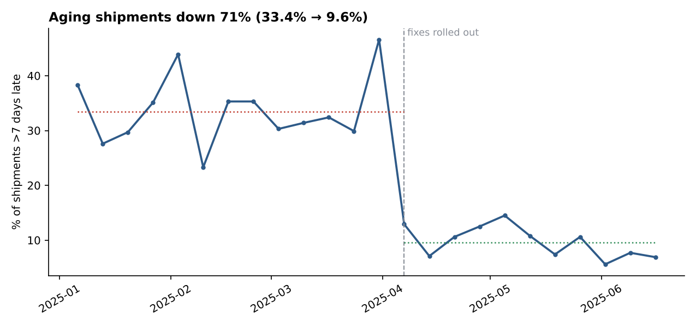
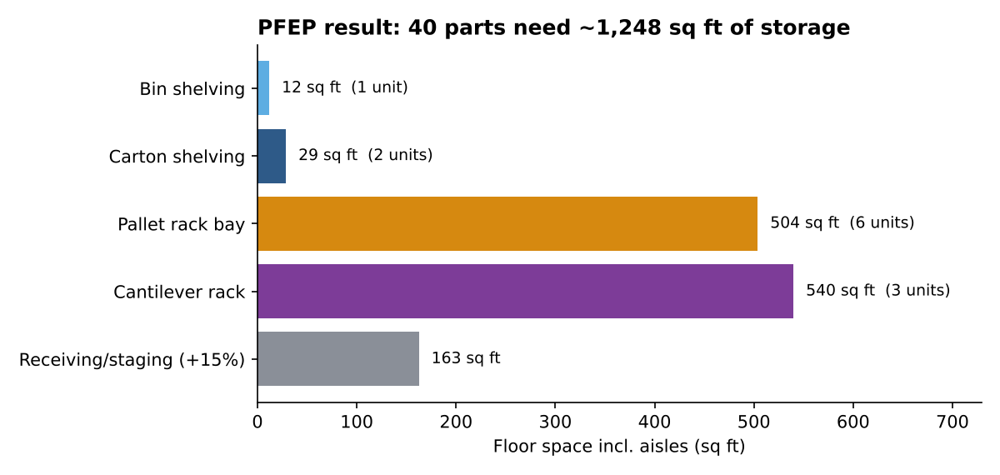

# Supply Chain & Process Engineering Analytics

Projects from my work in field service logistics and process engineering, rebuilt on **made-up sample data** so the methods can be shared publicly. Each folder has its own write-up with the problem, approach, results, and code you can run.

| Project | What it shows | Tools |
|---|---|---|
| [**Inventory Audit Framework**](inventory-audit/) | Cycle count vs. system accuracy by site; finds material booked to the wrong site | SQL, Pandas |
| [**Min/Max Forecasting**](min-max-forecasting/) | Weighted moving average forecast that resets reorder points monthly; back-tested with an inventory simulation | Python, NumPy |
| [**Fulfillment & Aging Shipment Dashboard**](fulfillment-dashboard/) | In-transit aging, PO deficits and on-time delivery for field sites | SQL, Pandas, Tableau, CSS |
| [**PFEP Space Calculator**](pfep-space-calculator/) | Plan For Every Part analysis that sizes storage space and exports an AutoCAD layout | Python, AutoCAD (DXF) |
| [Utilities](utilities/) | QR code label generator, transaction text cleaner and categorizer | Python, regex |

<p>
  
  
</p>

## Real-world results behind these projects
- **$30K+** in misallocated service materials uncovered by a site-level audit framework
- **60%** fewer stock shortages at a new distribution center using min/max forecasting
- **70%** fewer aging shipments through analysis of site-level delivery trends
- **100%** of aging purchase orders fulfilled through deficit analysis and vendor follow-up

## Run everything
```bash
pip install -r requirements.txt
python generate_sample_data.py          # rebuilds all sample data (fixed random seed)
python inventory-audit/audit_analysis.py
python min-max-forecasting/minmax_forecast.py
python fulfillment-dashboard/build_dashboard.py
python pfep-space-calculator/pfep_space_calculator.py
```

## About the data
Every dataset here is generated by `generate_sample_data.py`. Part numbers, sites, costs and quantities are random, and the SQL uses a generic schema. No employer data, table names or internal codes are included.

---
**Joel Espinoza** · Process Engineer · [LinkedIn](https://www.linkedin.com/in/joel-espinoza-028083256/)
