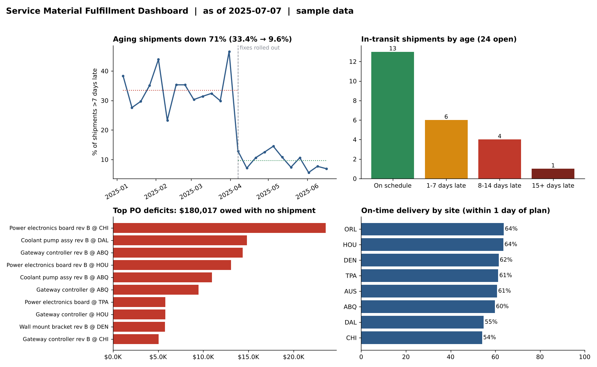
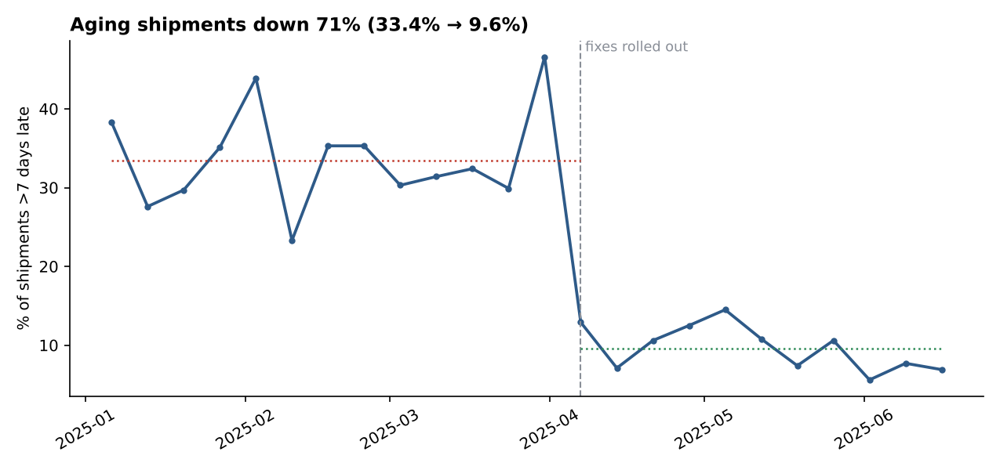

# Fulfillment & Aging Shipment Dashboard

**SQL (Vertica, via DBeaver) · Python (Pandas) · Tableau · CSS**

A dashboard that tracks inbound service material to field sites: what is in transit, what is aging past its planned delivery date, and which open purchase orders have nothing shipping against them.



## Problem
Technicians were arriving at jobs without parts. Shipments sat in transit for weeks with no one watching, and open purchase orders aged with no shipment against them, so shortages were only discovered when it was too late.

## Approach
1. **SQL** (`fulfillment_queries.sql`) pulls four views from shipment and purchase-order data:
   - `aging_in_transit`: every open shipment with days past plan and an aging bucket
   - `weekly_late_rate`: % of shipments arriving more than 7 days late, by week
   - `site_on_time`: on-time % and average transit days by site
   - `po_deficit`: open PO quantity minus in-transit quantity, by part and site. A positive number means material is owed with nothing on the way, and those lines are escalated to the vendor.
2. **Pandas** runs the queries and shapes the results.
3. **Dashboard:** in production, a Tableau dashboard alerted stakeholders to shortages. Here `build_dashboard.py` draws the same panels as an image, and `dashboard_theme.css` is the dark theme used for a web BI dashboard.
4. **Root-cause work:** site-level delivery trends showed where shipments stalled. Working with warehouse leads on those causes is what drove the drop in the chart below.



## Results
| | |
|---|---|
| **Real-world impact** | **Reduced aging shipments by 70%**; deficit analysis helped **fulfill 100% of aging orders**; reduced logistics costs and labor hours |
| Sample-data demo | Aging rate 33.4% → 9.6% (−71%) after fixes; 85 PO lines flagged as owed with no shipment |

## Files
| File | What it does |
|---|---|
| `fulfillment_queries.sql` | The four dashboard queries, rewritten against a generic sample schema |
| `build_dashboard.py` | Runs the queries in SQLite and builds `images/dashboard.png` and `images/aging_trend.png` |
| `dashboard_theme.css` | Dark theme for a web BI dashboard, controlled by CSS variables |
| `data/` | Made-up shipments, open POs and parts |
| `output/` | Query results as CSV |

## Run it
```bash
pip install -r ../requirements.txt
python build_dashboard.py
```

> **Note:** Table names, codes and data are generic or randomly generated. The production queries ran against a company data warehouse and aren't shared here.
