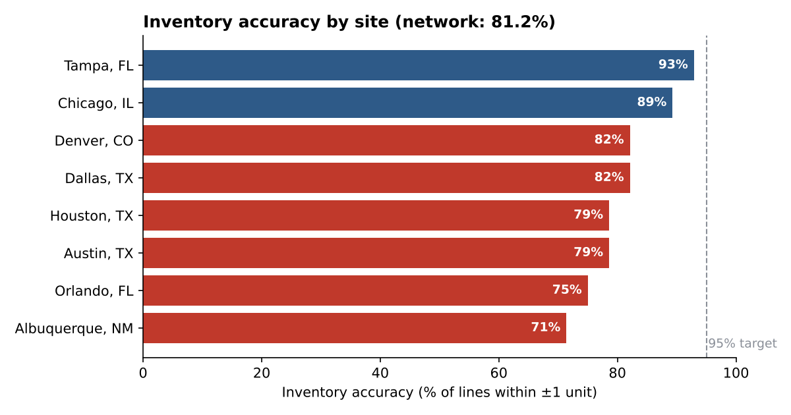
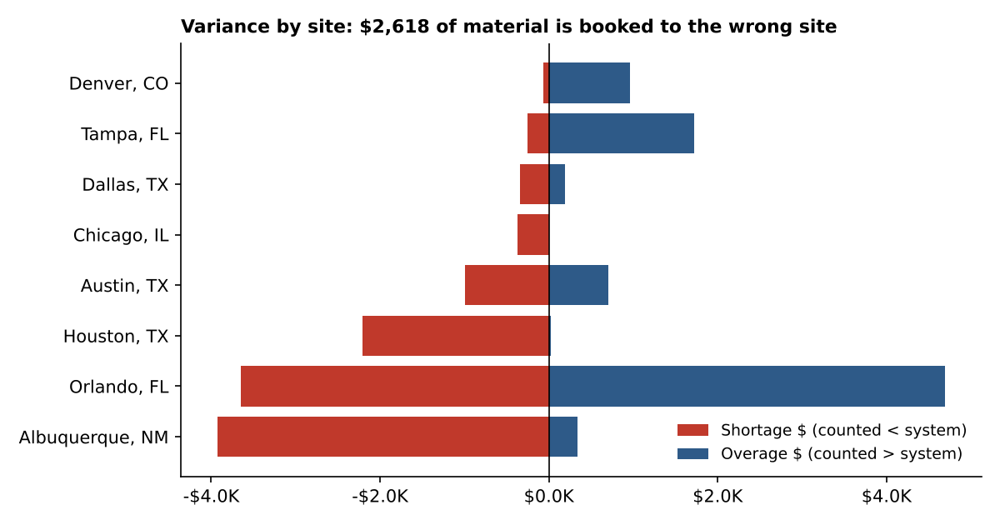

# Inventory Audit Framework

**SQL · Python (Pandas) · Matplotlib**

A site-level audit that compares what the system *says* is on the shelf with what a physical cycle count *finds*, then measures accuracy by site and flags material that is booked to the wrong location.



## Problem
Field service sites were running out of parts that the inventory system showed in stock, while other sites held extra stock nobody knew about. Planners were placing new orders for parts that already existed somewhere in the network.

## Approach
1. **Join system on-hand to cycle counts** for every site and part (`audit_queries.sql` → `line_variance`).
2. **Score each line:** within ±1 unit counts as accurate. Anything else is a shortage or an overage, valued at unit cost.
3. **Roll up by site** (`site_accuracy`): accuracy %, shortage $, overage $, net variance.
4. **Find misallocated material** (`misallocated_material`): parts that are over at one site and short at another. The smaller of the two quantities can be fixed with a **transfer instead of a purchase**.
5. **Suggest transfers** (`transfer_suggestions`): pairs each overage site with a shortage site for the same part, for a planner to review.



## Results
| | |
|---|---|
| **Real-world impact** | Rolled out across sites in Texas, Florida and Colorado; **uncovered $30K+ in misallocated service materials** |
| Sample-data demo | 8 sites, 224 count lines; network accuracy 81%; $2.6K of material flagged as fixable by transfer |

## Files
| File | What it does |
|---|---|
| `audit_queries.sql` | The four audit queries (standard SQL, labeled so Python can run each one) |
| `audit_analysis.py` | Loads the CSVs into SQLite, runs the queries, saves results and charts |
| `data/` | Made-up sample data: parts, sites, system inventory, cycle counts |
| `output/` | Query results as CSV |

## Run it
```bash
pip install -r ../requirements.txt
python audit_analysis.py
```

> **Note:** All data in this folder is randomly generated. The production version ran against a company data warehouse and isn't shared here.
