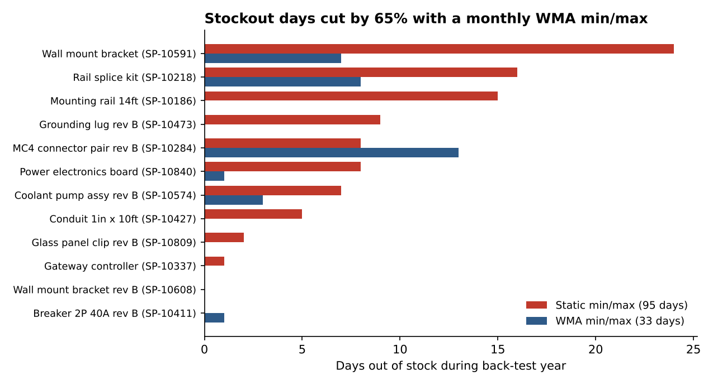
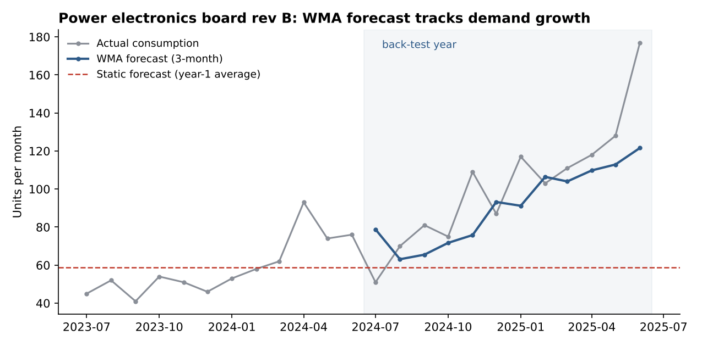

# Min/Max Forecasting

**Python (Pandas, NumPy) · Weighted Moving Average · Inventory Simulation**

A demand forecast that resets each part's **min** (reorder point) and **max** (order-up-to level) every month, back-tested against a static min/max with a day-by-day inventory simulation.



## Problem
A new distribution center was ramping up, and demand kept growing. Min/max levels set once from last year's average went stale within months: fast-growing parts stocked out while planners firefought with expedited orders.

## Approach
1. **Forecast** next month's demand with a 3-month weighted moving average (weights 0.5 / 0.3 / 0.2, most recent month heaviest), so the forecast follows trends instead of lagging behind a yearly average.
2. **Safety stock** = 1.65 × (std. dev. of the forecast's own recent errors) × √(lead time ÷ 30), which targets roughly a 95% service level.
3. **Min** = forecast daily demand × lead time + safety stock.
   **Max** = min + one month of forecast demand.
4. **Back-test:** year 1 builds history and year 2 is the test. Each part is simulated day by day (reorder when inventory position ≤ min, order up to max, the order arrives after the lead time), and the results are compared with a static min/max set once from year 1.



## Results
| | |
|---|---|
| **Real-world impact** | Built for a new distribution center in Mexico; improved inventory accuracy and **reduced stock shortages by 60%** |
| Sample-data demo | 12 parts, 12-month back-test: **stockout days 95 → 33 (−65%)**, fill rate 97.4% → 99.0%, forecast error (MAPE) 28.8% → 20.1% |

The WMA policy holds more units on hand in the sample, because demand grew through the test year and the static levels were sized for last year's volume. That trade-off is intended: inventory moves with demand instead of staying fixed.

## Files
| File | What it does |
|---|---|
| `minmax_forecast.py` | Forecast, min/max calculation, back-test simulation, charts |
| `data/monthly_consumption.csv` | 24 months of made-up consumption for 12 parts |
| `data/lead_times.csv` | Supplier lead time per part |
| `output/minmax_recommendations.csv` | Next month's forecast, min and max for every part |
| `output/backtest_summary.csv` | Stockout days, fill rate, avg on-hand and MAPE: static vs. WMA |

## Run it
```bash
pip install -r ../requirements.txt
python minmax_forecast.py
```

> **Note:** All data in this folder is randomly generated. Real-world results came from the production version.
