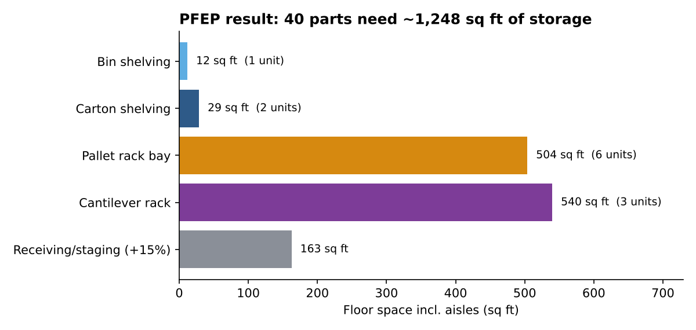
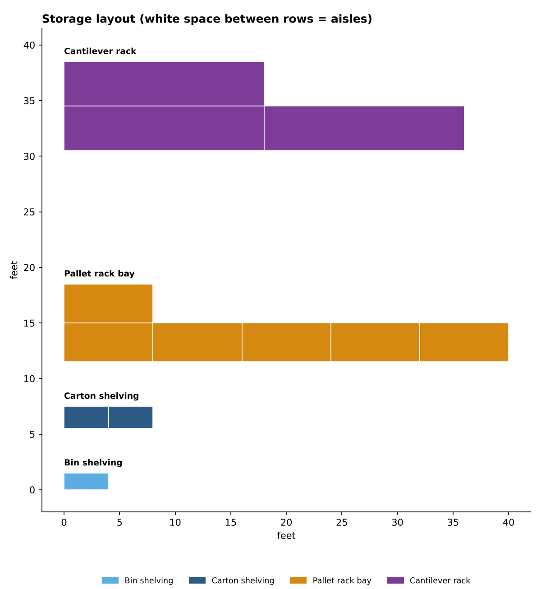

# PFEP Space Calculator

**Plan For Every Part · Python (Pandas) · AutoCAD (DXF export)**

A Plan For Every Part (PFEP) analysis that calculates how much storage space a parts list needs. It sizes each part's maximum stock, converts that to packs and cubic feet, assigns a storage type, totals the floor space, and exports a layout that opens in **AutoCAD**.



## Problem
Before re-laying out a service warehouse, the team needed to know how much space each part really needed and what type of storage it should go in. Space had been planned by guesswork, so some shelves overflowed while racks sat half empty.

## Approach
For every part in `data/pfep_parts.csv`:
1. **Days of cover** = replenishment frequency + safety stock days
2. **Max units** = daily usage × days of cover
3. **Max packs** = max units ÷ standard pack quantity, rounded up, with a two-pack minimum (one pack in use, one full)
4. **Cube** = max packs × pack length × width × height
5. **Storage type** from pack size and weight:
   - long items over 96" go to **cantilever rack**
   - more than 20 ft³ or packs over 50 lb go to **pallet rack**
   - small parts go to **bin shelving**
   - everything else goes to **carton shelving**
6. **Slots:** each part gets its own location(s), sized by the usable cube of a slot for its storage type
7. **Floor space** = units needed × unit footprint × an aisle factor, plus 15% for receiving and staging

The script then places the units in rows with aisles and writes `output/storage_layout.dxf`. Open that file in AutoCAD to finish the detailed layout around columns, doors and dock positions.



## Results
| | |
|---|---|
| **Real-world impact** | *[Add your result: square feet planned or saved, parts covered, or locations right-sized]* |
| Sample-data demo | 40 parts → 82 storage slots → ~1,250 sq ft including aisles and staging |

All equipment assumptions (slot sizes, slots per unit, footprints, aisle factors) are in the `STORAGE` table at the top of the script, so the calculation can be re-run for a different facility.

## Files
| File | What it does |
|---|---|
| `pfep_space_calculator.py` | PFEP calculations, storage assignment, space summary, layout and DXF export |
| `data/pfep_parts.csv` | Made-up PFEP inputs: usage, pack quantity and dimensions, replenishment, safety days |
| `output/pfep_space_plan.csv` | One row per part: max stock, packs, cube, storage type, slots |
| `output/space_summary.csv` | Units and square feet by storage type |
| `output/storage_layout.dxf` | Floor plan for AutoCAD (inches) |

## Run it
```bash
pip install -r ../requirements.txt
python pfep_space_calculator.py
```

> **Note:** All data in this folder is randomly generated.
